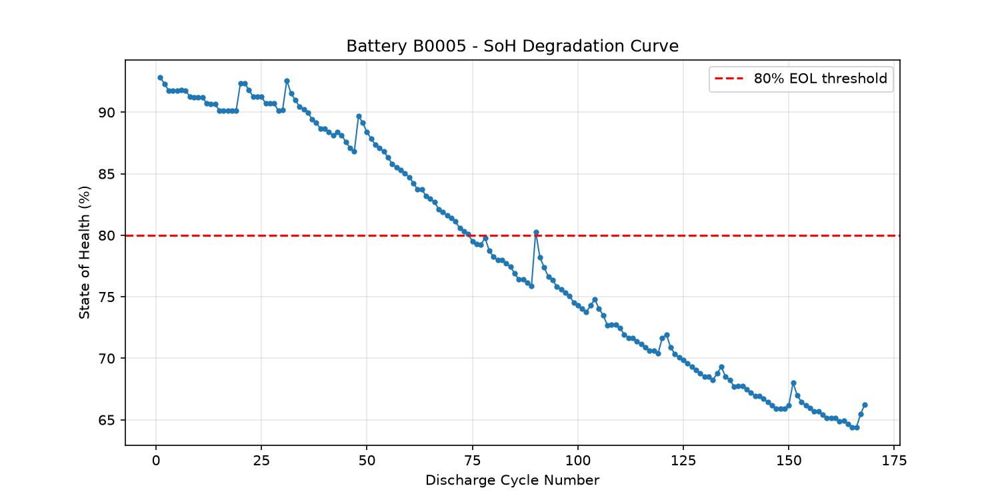
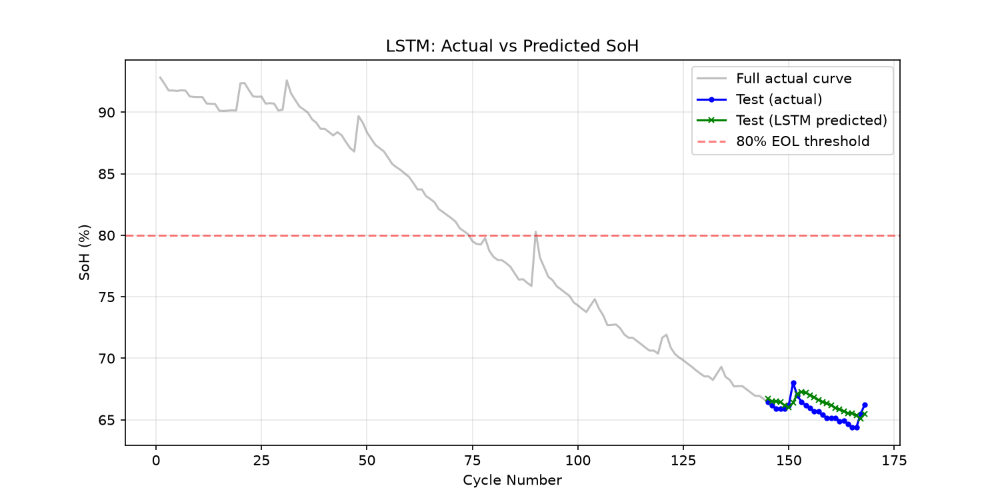

# AI-Based EV Battery State of Health (SoH) Estimation

An AI-powered system that predicts Li-ion battery State of Health from voltage, current, and temperature signals — trained on real NASA battery aging data, with a live Streamlit app and a hardware-ready pipeline for ESP32-based data logging.

**Live Demo:** [add your Streamlit Cloud link here once deployed]

---

## Problem Statement

Electric vehicle batteries degrade over time, losing usable capacity with every charge-discharge cycle. Knowing a battery's current State of Health (SoH) — the ratio of its current capacity to its original rated capacity — is critical for range prediction, safety, and battery replacement planning. Traditional SoH estimation requires a full discharge cycle to measure capacity directly, which is slow and impractical for real-time use.

This project uses machine learning to estimate SoH from short-term electrical signals (voltage, current, temperature) instead, without needing a full discharge cycle every time.

---

## Dataset

**NASA Li-ion Battery Aging Dataset** (NASA Prognostics Center of Excellence)
- Battery cell: B0005
- 168 discharge cycles used, each containing time-series voltage, current, and temperature readings
- Rated capacity: 2.0 Ah
- Source: NASA PCoE Battery Data Set

---

## Methodology

### 1. Feature Engineering
From each discharge cycle's raw voltage/current/temperature curves, 7 features were extracted:

| Feature | Description |
|---|---|
| `discharge_time_s` | Total time to discharge |
| `avg_temp_C` / `max_temp_C` | Average and peak temperature during discharge |
| `voltage_drop_rate` | Rate of voltage decline |
| `avg_current_A` | Average discharge current |
| `start_voltage_V` / `min_voltage_V` | Voltage range during discharge |

### 2. Baseline Model — Random Forest
A Random Forest Regressor was trained first as a baseline, using a time-based 85/15 train-test split (not random, to avoid data leakage and simulate real-world unseen degradation).

### 3. Advanced Model — LSTM
An LSTM (Long Short-Term Memory) network was trained on sliding windows of 10 consecutive cycles, learning the *trend* of degradation rather than treating each cycle independently. This was done specifically to fix a key limitation discovered in the Random Forest model (see Results).

---

## Results

| Model | RMSE | MAE | R² | Notes |
|---|---|---|---|---|
| Random Forest (85/15 split) | 1.80 | 1.63 | -3.59 | Fails to extrapolate into unseen, more-degraded cycles — predictions flatten out |
| **LSTM (sliding window)** | **0.87** | **0.78** | **-0.12** | Follows the real degradation trend into unseen cycles |

**Key finding:** Tree-based models (Random Forest) cannot predict values outside the range they were trained on, causing them to underestimate degradation in late-life cycles. LSTM, by learning sequential trends, generalizes better to unseen, more-degraded battery states — which is the exact scenario that matters most in real-world SoH estimation.




---

## Live Application

A Streamlit web app (`app.py`) brings the full pipeline together:
- Displays real model benchmark results
- Accepts an uploaded hardware CSV log (ESP32 format) and runs live feature extraction + prediction
- Shows the SoH degradation curve

Run locally:
```bash
pip install -r requirements.txt
streamlit run app.py
```

---

## Hardware Integration (Optional Extension)

Designed to accept live sensor data from a low-cost ESP32-based logger, even though final results in this submission are based on the NASA benchmark dataset:

- **Circuit**: 18650 Li-ion cell + INA219 (voltage/current sensor) + DS18B20 (temperature sensor) + ESP32 + MOSFET-controlled discharge
- **Firmware**: `hardware/battery_data_logger.ino` — logs voltage, current, temperature every second in CSV format
- **Pipeline**: `src/hardware_to_feature.py` converts raw logs into the same 7 features used in training; `src/predict_from_hardware.py` runs them through the trained LSTM model

This makes the project hardware-ready: once physical hardware is available, no model retraining is needed — only the feature converter is used to bridge raw sensor data into the existing model.

---

## Project Structure
```
EV-Battery-SoH-Estimation/
├── app.py                   # Main Streamlit application
├── requirements.txt
├── data/                    # Raw NASA .mat files
├── models/                  # Trained model weights (.pth)
├── notebooks_or_results/    # Processed datasets, plots, predictions
├── hardware_logs/           # ESP32 sensor logs (real or simulated)
├── src/                     # All processing and training scripts
├── hardware/                # ESP32 firmware (.ino)
└── legacy/                  # Earlier prototype dashboard (HTML/JS)
```

---

## Tech Stack
- **Data processing:** Python, Pandas, NumPy, SciPy
- **Machine Learning:** scikit-learn (Random Forest), PyTorch (LSTM)
- **Visualization:** Matplotlib, Streamlit
- **Hardware:** ESP32, INA219, DS18B20 (optional extension)

---

## Limitations
- Current results are based on a single battery cell (B0005); cross-battery generalization has not yet been validated
- Hardware pipeline has been tested with simulated sensor data only, not a physical circuit
- LSTM was trained on a relatively small dataset (168 cycles); more cycles and more cells would likely improve robustness

---

## Future Work
- Train and validate across multiple NASA cells (B0006, B0007, B0018) to test true cross-battery generalization
- Add Remaining Useful Life (RUL) prediction alongside SoH
- Add model explainability (SHAP) to identify which features drive predictions
- Build and test the physical ESP32 hardware logger
- Deploy a permanently hosted API backend for real-time predictions

---

## Author
Ayush Mishra
ABES ENGINEERING COLLEGE
30/09/26